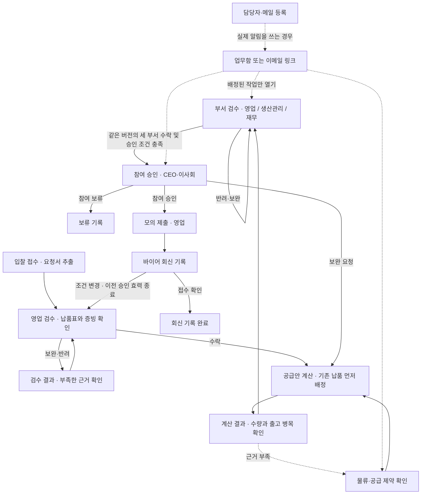

# Corevia 사용 흐름

일반 검토는 한 브라우저에서 활성 입찰 한 건을 처리합니다. 아래 흐름을 처음 따라갈 때는 **모의 입찰 → 예시 입찰 접수부터 직접 진행**을 선택하세요. 각 화면에서 해당 예시를 채우고 내용을 확인한 뒤 저장하거나 계산하세요. [공개 앱](https://corevia-1p74.axhub.page/)

| 화면 | 담당자가 확인하고 입력할 것 | 다음 화면 |
| --- | --- | --- |
| 입찰 접수 | 요청서 원문을 넣고 조건 추출. 체험에서는 **체험용 입찰서 채우기** 사용 | 영업 검수 |
| 영업 검수 | 품목, 초도일, 날짜·품목별 납품 수량과 바이어 증빙. 보완·반려는 사유를 기록 | 수락하면 공급안 계산, 보완·반려면 검수 결과 |
| 공급안 계산 | **확정 납품표와 공급 근거 불러오기** 후 기존 납품, 생산 여력, 공동 출고 한도와 예약을 확인하고 계산 | 계산 결과 |
| 계산 결과 | 기존 납품 부족, 제안 후보, 출고 차감, 품목별 근거 확인 | **다음 · 부서별 검수**를 눌러 인계 |
| 부서 검수 | 영업·생산관리·재무가 같은 버전을 검수. 이전 반려를 수락으로 바꿀 때 보완 종료 근거 기록 | 조건 충족 시 참여 승인 |
| 참여 승인 | 제안량·납품일, 부서 검수, 계약 위험과 경제성 근거를 확인하고 결정 사유 기록 | 승인 시 모의 제출, 보완 시 공급안 계산, 보류 시 결정 기록 |
| 모의 제출·회신 | 승인된 제안서를 제출로 기록한 다음 회신의 유형·근거·담당자 입력 | 접수 확인은 회신 완료, 조건 변경은 영업 검수와 재계산 |

### 처음 써볼 때

1. **예시 입찰 접수부터 직접 진행**에서 기초 10,000 EA와 더마 6,000 EA가 배정되는지 확인하세요. **다음 부서 검수 예시 채우기**와 저장을 반복하면 아직 수락하지 않은 부서로 넘어갑니다. 생산관리를 한 번 반려하면 참여 승인이 잠기고, 예시를 다시 채울 때 보완 종료 근거가 들어갑니다.
2. 참여 승인과 모의 제출 후 **바이어 감량 요청 예시 채우기**를 눌러 저장하세요. 영업 검수 예시로 수정 납품표와 증빙을 채운 다음 물류 업무함에서 배정된 작업의 예시를 채워 저장하면 2,000 EA가 계산됩니다. 부서 검수와 재승인·제출을 거쳐 **바이어 접수 확인 예시 채우기**로 체험을 마칠 수 있습니다.
3. **출고 변경과 재검수 과정 보기**는 미리 준비한 시연을 열고, **현재 입력으로 공급량 계산**은 랜덤 입찰 검증 화면에 표시된 값으로 계산합니다.

실제 이메일을 쓰려면 일반 검토의 **담당자·메일 등록**에서 역할별 주소와 알림을 켜고 발송 키를 입력하세요. 서버에 허용된 주소로 발송됩니다. 링크에서 업무를 열려면 해당 업무가 저장된 같은 브라우저와 프로필이 필요합니다.
